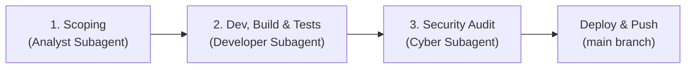

# 🛠️ The Forge: Multi-Agent Engineering Pipeline

The Forge is the standard end-to-end development pipeline for the **discord-bot** repository. It coordinates three dedicated subagents sequentially to deliver robust, well-architected, fully tested, and secure software.

---

## ⚡ Guiding Rules

1. **Flash Model by Default:**
   All subagents systematically use the **Flash model** (`flash` or `inherit`). Calibrate thinking/reflection levels based on the complexity of the phase:
   - Deep reflection for complex scoping, tricky refactoring, and security audits.
   - Direct/focused reflection for standard code updates and unit testing.
2. **Strict Project Standards:**
   Every subagent must respect the project standards defined in [AGENTS.md](file:///c:/Dev/discord-bot/AGENTS.md) (Primary Constructors, `TimeProvider`, `IFileSystem`, Strongly Typed Models, Early Return, NUnit + FluentAssertions).
3. **Developer Ownership of Build & Tests:**
   The Developer subagent is responsible for both implementation AND full test verification. It builds the solution, writes unit tests, executes the test suite in Docker, and self-heals until reaching a 100% green state.
4. **Deployment Safety:**
   **NEVER push to the `production` branch autonomously.** All commits are pushed to `main` only.
5. **Proportionality:**
   Micro-tasks (typos, 2-line CSS fixes, static string updates) use a fast-track: direct implementation with build/test validation, bypassing the multi-agent ceremony.

---

## 🔄 The 3-Stage Pipeline



---

### Phase 1: Requirements Analysis & Interactive Scoping
* **Subagent Role:** `Requirements Analyst` (`TypeName: "self"`, `Role: "Requirements Analyst"`, `Model: "flash"`).
* **Mission:**
  1. Inspect the codebase, current architecture, existing models, and configuration services.
  2. Identify ambiguities, missing requirements, data storage needs, and edge cases.
  3. Proactively ask clarifying questions using `ask_question` or structured chat to define scope and user preferences.
  4. Establish an actionable, validated implementation plan before any code is written.
  * *Constraint:* Never begin writing non-trivial code without user alignment on requirements.

---

### Phase 2: Implementation, Build & Unit Testing
* **Subagent Role:** `Developer` (`TypeName: "self"`, `Role: "Developer"`, `Model: "flash"`).
* **Mission:**
  1. Implement features, models, services, Blazor components, or schedulers as scoped in Phase 1.
  2. Enforce all core directives from [AGENTS.md](file:///c:/Dev/discord-bot/AGENTS.md):
     - **Primary Constructors:** Always use primary constructors without redundant `private readonly` fields.
     - **Modern C# 13 / .NET 10:** Collection expressions `[...]`, pattern matching, clean `using` directives.
     - **No Tuples:** Return explicit typed objects (`record`, `class`).
     - **Control Flow:** Early return pattern (guard clauses).
     - **TimeProvider:** Injected `TimeProvider` abstraction, never hardcoded `DateTime.Now`.
     - **FileSystem:** Injected `IFileSystem`, never static `System.IO.File`.
     - **Blazor Lifecycle:** Implement `IDisposable` when subscribing to events and call `InvokeAsync(StateHasChanged)`.
  3. **Build & Unit Test Verification (Developer Responsibility):**
     - Write and update comprehensive NUnit unit tests (`tests/DiscordBot.Tests/`).
     - Compile and run the test suite in the isolated .NET 10 Docker environment:
       ```powershell
       docker run --rm -v "${PWD}:/src:ro" mcr.microsoft.com/dotnet/sdk:10.0 bash -c "cp -r /src /tmp/build && cd /tmp/build/tests/DiscordBot.Tests && dotnet test --verbosity normal"
       ```
     - In case of compilation issues, warnings, or test failures, directly diagnose root causes and apply fixes until achieving a **100% green state (0 warnings, 0 errors, 100% tests passed)**.
  * *Constraint:* Cybersecurity review can only begin once 100% of unit tests pass cleanly.

---

### Phase 3: Systematic Cybersecurity Review
* **Subagent Role:** `Cybersecurity Auditor` (`TypeName: "self"`, `Role: "Cybersecurity Auditor"`, `Model: "flash"`).
* **Mission:**
  1. **CVE Scanning:** Audit dependencies for known vulnerabilities:
     ```powershell
     docker run --rm -v "${PWD}:/src:ro" mcr.microsoft.com/dotnet/sdk:10.0 dotnet list /src/DiscordBot.csproj package --vulnerable --include-transitive
     ```
  2. **Code & Dataflow Audit:**
     - Injections (Discord mention pings `@everyone`, `@here`, `<@`, XSS in Blazor, SSRF in URLs).
     - Authentication & Authorization: Ensure administrative pages have `@attribute [Authorize(Policy = "AdminOnly")]`.
     - Secrets: Validate that tokens/secrets are never logged or exposed in plain text.
     - Thread-safety & DoS: Validate non-blocking locks (`SemaphoreSlim`), resource limits, timeouts.
     - Memory Leaks: Validate proper event unsubscribe in `Dispose()`.
  3. Apply any defensive mitigations or hardening directly before release.

---

## 🚀 Delivery & Finalization

Once Phase 3 is approved:
1. Rebuild and restart the Docker container:
   ```powershell
   docker compose up -d --build
   ```
2. Check container logs to verify clean startup and Discord connection:
   ```powershell
   docker compose logs --tail 25
   ```
3. Commit and push to git:
   ```powershell
   git add .
   git commit -m "feat/fix: <description>"
   git push origin main
   ```
   *(Reminder: Strictly NEVER push to `production` autonomously).*
4. Deliver a concise summary to the user outlining implemented features, test metrics, and security audit results.
